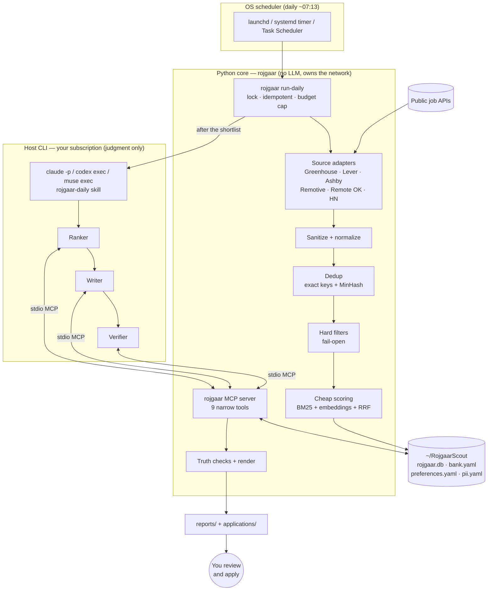

# Rojgaar-Scout-Agent

**A local-first job search agent that runs inside AI coding CLIs — Claude Code, OpenAI Codex CLI and Meta Muse Code.**
Every morning it scans job boards, ranks new openings against your profile, writes a report of the best matches, and drafts a tailored CV and cover letter for each one.

> **It never submits an application.** There is no submit, form-fill, email or login tool anywhere in the code. You review the drafts and apply yourself.

MIT licensed · Python ≥ 3.11 · runs on your machine · your data stays in `~/RojgaarScout`

---

## Contents

- [What it does](#what-it-does)
- [Architecture](#architecture)
- [Technology stack and options](#technology-stack-and-options)
- [Setup](#setup)
- [Run it](#run-it)
- [Connect your AI CLI](#connect-your-ai-cli)
- [Configuration](#configuration)
- [Command reference](#command-reference)
- [Testing](#testing)
- [Data, privacy and source terms](#data-privacy-and-source-terms)
- [Project layout](#project-layout)
- [Status, limitations and roadmap](#status-limitations-and-roadmap)
- [Contributing](#contributing)

---

## What it does

| Step | Who does it | What happens |
|---|---|---|
| 1. Fetch | Python | Reads public job APIs: employer boards on Greenhouse, Lever and Ashby, plus Remotive, Remote OK and Hacker News "Who is hiring" |
| 2. Clean | Python | Strips hidden text and invisible Unicode (prompt-injection carriers), normalizes every posting to one schema |
| 3. Dedup | Python | Merges the same job seen on several boards (exact keys first, MinHash for reposts) |
| 4. Filter | Python | Your hard rules — **San Francisco, Bay Area, remote-US** by default, salary floor, seniority, age. Missing fields never drop a job (*fail-open*) |
| 5. Score | Python (laptop CPU) | BM25 keyword relevance, optionally fused with local embeddings via Reciprocal Rank Fusion → shortlist of ~40 |
| 6. Rank | Your AI CLI | A rubric judge scores each shortlisted job 0–3 on five dimensions with evidence; **code** computes the final score from your weights |
| 7. Draft | Your AI CLI | For the top 5, a CV and cover letter built only from verified claims in your experience bank, each bullet citing its source |
| 8. Verify | Python + AI CLI | Deterministic truth checks (numbers, skills, qualifiers, timeline) plus a fresh-context verifier. Any error blocks the draft |
| 9. Report | Python | `reports/YYYY-MM-DD.md` and one folder per job with `jd.md`, `fit-report.md`, `cv.md`, `cover-letter.md`, `review.md`, `status.json` |

---

## Architecture

### Design principles

1. **Anything with a correct answer is code; anything that needs taste is the LLM.** Fetching, deduplication, filtering and rendering are deterministic, free and unit-tested. The model only ranks a shortlist and drafts.
2. **No "lethal trifecta".** An agent that holds private data, reads untrusted text and can send data out can be hijacked by a malicious job posting. So all network access happens in Python *before* any agent runs, and agents get only narrow MCP tools (no web, shell, email or submit).
3. **Truthfulness is enforced in code.** A 2026 study found strict prompts alone still left a fabrication in half of tailored resumes. Every bullet cites claim IDs, and code checks it against the bank.
4. **Fail-open filters.** A posting that doesn't state salary or visa info is kept, not silently dropped.
5. **One core, three hosts.** The same skills and MCP server work in Claude Code, Codex and Muse.

### System diagram



The same design is on the **Rojgaar-Scout System Design** canvas, which has three boards: the architecture, the daily-run funnel, and data and trust.

### Components

| Module | Responsibility |
|---|---|
| `http.py` | The only network client: honest User-Agent, 1 request per host at a time with delay, `Retry-After`, bounded retries, robots.txt |
| `sources/` | One adapter per board; maps responses to `models.Job` |
| `sanitize.py` | HTML → text; removes hidden text and invisible Unicode; flags injection attempts |
| `dedup.py` | Canonical URLs, exact dedup keys, MinHash repost detection |
| `store.py` | SQLite: jobs (`first_seen`/`last_seen`), dedup keys, runs, fetch caps, shortlists, rankings, feedback |
| `locations.py` | Metro alias table (`Bay Area, CA` → San Jose, Oakland, Palo Alto …) and remote-scope detection |
| `filters.py` · `risk.py` | Stage 1 hard filters with drop reasons; ghost/scam risk badges |
| `scoring.py` | Stage 2: BM25, optional fastembed, Reciprocal Rank Fusion |
| `rubric.py` | Stage 3 contract: the judge's JSON schema and the weighted score computed in code |
| `bank.py` · `truth.py` | Experience bank and deterministic truth checks |
| `mcp_tools.py` · `mcp_server.py` | The 9 tools the model may use, and the stdio MCP server (SDK 2.x and 1.x) |
| `applications.py` · `render.py` | Per-job folders; Markdown CV and cover letter; RenderCV YAML for PDF |
| `daily.py` · `hosts.py` · `schedule.py` | `run-daily`, headless host commands (no bypass flags), OS schedule files |
| `hostsetup.py` | Writes skills, `AGENTS.md`, `.mcp.json`, Codex `config.toml` and Muse `settings.json` entries |

### MCP tools exposed to the model

`get_shortlist` · `get_job` · `get_profile` · `get_bank` · `save_rankings` · `check_draft` · `save_application_draft` · `finalize_report` · `record_feedback`

There is deliberately no tool for fetching URLs, running shell commands, sending email or submitting applications. Nothing from `pii.yaml` is ever returned.

---

## Technology stack and options

### Chosen stack

| Concern | Choice | Why |
|---|---|---|
| Language | **Python 3.11+** | Best ecosystem for scraping-free API clients, NLP and resume rendering; the MCP Python SDK is official |
| Packaging | **uv** + hatchling, `uvx rojgaar-scout` | Fast, reproducible, no global installs |
| HTTP | **httpx** | Sync/async, timeouts, and `MockTransport` for fully offline tests |
| Validation | **pydantic v2** | Typed models, and JSON Schemas for the judge and draft contracts |
| Storage | **SQLite** (stdlib) | One local file, no server; FTS5 and sqlite-vec available later |
| Agent interface | **MCP over stdio** (`mcp` SDK 2.x, 1.x fallback) | The one tool layer Claude Code, Codex and Muse all support |
| Agent instructions | **Agent Skills** (`SKILL.md`) + `AGENTS.md` | Portable across all three hosts |
| Ranking | Pure-Python **BM25** + optional **fastembed** (`bge-small-en-v1.5`) + **RRF** | Free, local, deterministic; embeddings are optional |
| Rendering | Markdown always; **RenderCV** (Typst) for PDF; Pandoc for DOCX (planned) | ATS-friendly single column, no LaTeX install |
| Scheduling | **launchd / systemd timer / Task Scheduler** | Catch up after sleep; CLI schedulers don't fit a local daily job |
| Tests | **pytest** with **JUnit XML** reports | Same report format CI systems read from JUnit |
| CI | **GitHub Actions** (Ubuntu + macOS × Python 3.11–3.13) | Lint, unit and integration tests, JUnit artifacts |

### Options considered

| Concern | Option | Trade-off | Verdict |
|---|---|---|---|
| Language | TypeScript (Node) | Great MCP SDK, npm distribution; weaker resume/NLP tooling | Viable for a future MCP-only port |
| Language | Go | Single static binary; thin ecosystem for embeddings and resume rendering | Not now |
| Language | Java/Kotlin + **JUnit 5** | Familiar to enterprise teams; heavy runtime for a local CLI tool, poor fit with `uvx`-style installs | Not chosen; pytest emits JUnit-format XML instead |
| Storage | DuckDB | Excellent analytics; SQLite is simpler for transactional upserts | SQLite |
| Storage | Postgres | Needs a server, against local-first | No |
| Embeddings | Ollama (`nomic-embed-text`) | Easy if you already run Ollama | Supported via the `Embedder` protocol (add an adapter) |
| Embeddings | sentence-transformers | Best quality options; pulls in PyTorch (GBs) | Optional |
| Vector store | sqlite-vec / LanceDB / Chroma | Not needed below ~10k jobs; numpy is enough | Later |
| Rendering | LaTeX (moderncv, Jake's) | Beautiful; large install, harder for agents to drive | RenderCV/Typst |
| Rendering | JSON Resume + `resumed` | Good export format; reference CLI archived in 2026 | Export only |
| Scheduling | Claude/Codex/Muse built-in schedulers | Cloud tasks lack local files; desktop tasks need the app open | OS scheduler |
| Data | JobSpy (LinkedIn/Indeed scrapers) | Broad coverage; terms and ban risk | Opt-in only (planned), never default |
| Host LLM | API key vs subscription login | Subscription is cheaper per user; scheduled use may raise terms questions | Both supported; see limitations |

---

## Setup

### Prerequisites

- Python **3.11+** and [uv](https://docs.astral.sh/uv/) (or pipx/pip)
- Optional: one or more host CLIs — `claude` (Claude Code), `codex` (OpenAI Codex CLI), `muse` (Meta Muse Code)

### Install

**From source (recommended while in 0.x):**

```bash
git clone https://github.com/<your-org>/Rojgaar-Scout-Agent.git
cd Rojgaar-Scout-Agent
make install                     # uv venv + editable install with dev extras
source .venv/bin/activate
rojgaar --version
```

**With pipx or uv tool** (once published to PyPI):

```bash
uv tool install "rojgaar-scout[mcp]"    # or: pipx install "rojgaar-scout[mcp]"
```

Optional extras: `[embeddings]` for local embeddings (fastembed) and `[render]` for PDF via RenderCV.

### Create your data folder

```bash
rojgaar init                     # creates ~/RojgaarScout (override with --home or ROJGAAR_HOME)
```

This creates:

```
~/RojgaarScout/
├── profile/preferences.yaml   ← where to search and your filters (SF, Bay Area, remote-US by default)
├── profile/bank.yaml          ← every true claim about you, with IDs (replace the example!)
├── profile/pii.yaml           ← name, email, phone — never sent to a model
├── config/companies.us.yaml   ← which employers to watch, and their ATS board slugs
├── AGENTS.md · CLAUDE.md · .mcp.json · .agents/skills/ · .claude/skills/
├── state/  reports/  applications/
```

### Fill in your profile

1. **`profile/bank.yaml`**: replace the example roles and claims with your own. Keep qualifiers honest ("co-led", "helped", "team of 4"), and set `verified_by_user: true` only on claims you have checked.
2. **`profile/preferences.yaml`**: adjust the salary floor, seniority, target titles and core skills.
3. **`profile/pii.yaml`**: your contact details.
4. **`config/companies.us.yaml`**: the seed entries are *unverified examples*. Run `rojgaar companies check` to confirm each board answers, and add companies with `rojgaar companies detect <careers-url>`.

```bash
rojgaar doctor                   # checks every piece and tells you what to fix
```

---

## Run it

### Without any AI CLI (deterministic report)

```bash
rojgaar fetch                    # pull new postings from enabled sources
rojgaar shortlist                # hard filters + cheap scoring; prints drop reasons
rojgaar report                   # writes ~/RojgaarScout/reports/YYYY-MM-DD.md
```

Or all at once:

```bash
rojgaar run-daily --host none
```

### With your AI CLI (ranking + drafts)

```bash
rojgaar setup claude             # or: codex | muse
rojgaar run-daily --host claude  # fetch → shortlist → report → host ranks, drafts, verifies → final report
```

`run-daily` is idempotent: a second run on the same day does nothing unless you pass `--force`. If the host fails or times out, the no-LLM report is still there.

### Schedule it daily

```bash
rojgaar schedule print --host claude --time 07:13     # show what would be installed
rojgaar schedule install --host claude --time 07:13   # macOS launchd · Linux systemd timer · Windows Task Scheduler
```

### Review and apply

Open `reports/<date>.md`, then each `applications/<date>_<company>_<role>/` folder:

- `review.md` puts every CV bullet beside the claim it came from, and lists any findings.
- `fit-report.md` marks each requirement ✔ met, ≈ partial or ✘ missing. Missing skills are never added to your CV.
- `cover-letter.md` leaves the motivation line for you to write.

Then apply on the employer's site yourself.

---

## Connect your AI CLI

All three hosts use the same skills (`rojgaar-daily`, `rojgaar-rank`, `rojgaar-tailor`, `rojgaar-verify`) and the same MCP server. `run-daily` runs the host inside `~/RojgaarScout`, so it picks up the workspace files written by `rojgaar setup`.

| Host | Setup | Headless command used by `run-daily` |
|---|---|---|
| **Claude Code** | `rojgaar setup claude` writes `.mcp.json` and `.claude/skills/` in the workspace. Alternatively, install the plugin: `/plugin marketplace add <this-repo>` | `claude -p "<prompt>" --output-format json --permission-mode dontAsk --allowedTools "mcp__rojgaar__*" --max-budget-usd 2` |
| **Codex CLI** | `rojgaar setup codex` adds `[mcp_servers.rojgaar]` to `~/.codex/config.toml` (backed up first). Subagents: `.codex/agents/*.toml` | `codex exec --json --sandbox workspace-write "<prompt>"` |
| **Muse Code** | `rojgaar setup muse` adds `mcp_servers.rojgaar` to `~/.config/muse/settings.json` (`schema_version: 1`) | `muse exec --json --disable-approval --max-model-steps 120 "<prompt>"` |

**Interactive use:** open your CLI in `~/RojgaarScout` and say *"run the rojgaar daily review"*.

**Never** run the scheduled job with `--yolo`, `--dangerously-skip-permissions`, `danger-full-access` or `bypassPermissions`. `hosts.py` refuses to build such a command.

---

## Configuration

Excerpt of `profile/preferences.yaml` (full commented file: `src/rojgaar/data/preferences.example.yaml`):

```yaml
markets:
  us:
    locations: ["San Francisco, CA", "Bay Area, CA", remote-US]
    work_authorization: citizen
    drop_if_no_sponsorship: false
    salary_floor: {amount: 150000, currency: USD, period: year}
    sources: [greenhouse, lever, ashby, remotive, remoteok, hn_whos_hiring]
include_remote_global: true
filters:
  remote_modes: [remote, hybrid, onsite]
  seniority: [senior, staff]          # ±1 level allowed
  max_age_days: 30
  exclude_title_words: [intern]
ranking:
  target_titles: [Backend Engineer, Platform Engineer]
  core_skills: {Python: 3, Go: 3, PostgreSQL: 2}
  weights: {title: 2, must_have: 3, seniority: 2, logistics: 2, preference: 1}
report: {top_n: 15, drafts_per_day: 5, new_only: true, shortlist_size: 40}
```

Environment variables:

| Variable | Purpose |
|---|---|
| `ROJGAAR_HOME` | Data folder (default `~/RojgaarScout`) |
| `ROJGAAR_NO_EMBED` | Set to disable embeddings (BM25 only) |
| `ROJGAAR_CLAUDE_BIN` · `ROJGAAR_CODEX_BIN` · `ROJGAAR_MUSE_BIN` | Custom path to a host executable |
| `ANTHROPIC_API_KEY` · `CODEX_API_KEY` · `META_API_KEY` | Use an API key instead of a subscription login for scheduled runs |

---

## Command reference

| Command | What it does |
|---|---|
| `rojgaar init [--force]` | Create the data folder, starter files and workspace |
| `rojgaar fetch [--source NAME]` | Fetch new postings (per-source counts, errors, skips) |
| `rojgaar shortlist [--n N] [--date D]` | Filter and score; prints drop reasons and the top 20 |
| `rojgaar report [--date D]` | Write the Markdown report |
| `rojgaar run-daily [--host claude\|codex\|muse\|none] [--force] [--timeout S]` | The full daily run |
| `rojgaar check-draft FILE [--json]` | Truth-check a draft (exit 1 if blocked) |
| `rojgaar companies list\|check\|detect URL\|discover URL` | Manage the company registry |
| `rojgaar schedule print\|install [--host H] [--time HH:MM] [--platform P]` | Daily OS schedule |
| `rojgaar setup claude\|codex\|muse` | Wire skills and the MCP server into a host |
| `rojgaar doctor` | Check your setup |
| `rojgaar feedback UID up\|down [--reason R]` | Record your reaction to a job |
| `rojgaar schema judge\|draft` | Print the JSON schema the model must follow |
| `rojgaar mcp` | Start the stdio MCP server |

---

## Testing

```bash
make test          # all tests → reports/junit.xml
make unit          # tests/unit        → reports/junit-unit.xml
make integration   # tests/integration → reports/junit-integration.xml
make lint
```

- **Fully offline.** HTTP is mocked with `httpx.MockTransport` and recorded fixtures in `tests/fixtures/` (one per source).
- **JUnit XML.** Every run writes JUnit-format XML, which Jenkins, GitHub Actions, GitLab and Azure DevOps all read. pytest is the Python counterpart of JUnit.
- **Unit tests (190)** cover each module in isolation:
  - salary parsing, locations and the Bay Area alias table, the sanitizer's injection cases, HTTP politeness (Retry-After, per-host delay, robots.txt);
  - every source adapter, dedup (cross-board, Engineer I vs II, MinHash reposts), fail-open filters, risk;
  - BM25 and RRF, the rubric, **planted-fabrication truth checks** (invented metric, dropped "co-", trap skill, anachronism, missing or unknown source);
  - host commands with no bypass flags, schedule files, Codex/Muse config writers, report rendering, the lock.
- **Integration tests (28)** cover whole flows:
  - the full pipeline across all six sources, including cross-board dedup, fetch caps, a failing source and the next-day "new only" rule;
  - `run-daily` with a **fake host CLI that acts as an agent through the real MCP tools**, plus host failure, missing host, timeout and idempotency;
  - the MCP server in-process **and over real stdio**, with a PII-leak scan of every read tool;
  - the CLI end to end.

CI runs lint plus unit and integration tests on Ubuntu and macOS with Python 3.11–3.13, and uploads the JUnit reports as artifacts.

---

## Data, privacy and source terms

| Data | Stays local | Sent to your model provider |
|---|---|---|
| Job postings | ✔ (SQLite) | Shortlisted job text, sanitized |
| `bank.yaml` claims | ✔ | Verified claims only (needed to rank and draft) |
| `pii.yaml` | ✔ | **Never**: prompts use `{{NAME}}`-style placeholders, filled in locally at render time |
| Reports and drafts | ✔ | — |

Sources and their tiers are listed in `src/rojgaar/data/sources.yaml`:

| Tier | Sources | Rules |
|---|---|---|
| Safe default | Greenhouse, Lever, Ashby (official public endpoints), Remotive (≤4/day), Remote OK (attribution), HN via Algolia | Honest UA, one request per host, caching, caps enforced in code |
| Opt-in (planned) | Workday `cxs`, Adzuna, Jooble, JobSpy-Indeed, job-alert email parsing | User must enable and acknowledge a warning |
| Avoid | LinkedIn, Glassdoor | Terms forbid automated access; no adapter ships |

No CAPTCHA solving, no stealth browsers, no proxy rotation, no logging in on your behalf.

---

## Project layout

```
Rojgaar-Scout-Agent/
├── src/rojgaar/
│   ├── cli.py  daily.py  pipeline.py  hosts.py  schedule.py  hostsetup.py  doctor.py
│   ├── http.py  sources/{greenhouse,lever,ashby,remotive,remoteok,hn}.py
│   ├── sanitize.py  dedup.py  store.py  locations.py  filters.py  risk.py  scoring.py
│   ├── bank.py  truth.py  rubric.py  render.py  applications.py  report.py
│   ├── mcp_tools.py  mcp_server.py
│   └── data/  preferences.example.yaml  bank.example.yaml  pii.example.yaml
│              companies.us.yaml  metros.yaml  sources.yaml  skills/*/SKILL.md
│   (skills ship inside the package; `rojgaar setup` copies them to .agents/skills and .claude/skills)
├── .claude-plugin/{plugin.json,marketplace.json}  # Claude Code plugin
├── plugin/agents/{ranker,writer,verifier}.md      # Claude subagents
├── .codex/agents/{ranker,writer,verifier}.toml    # Codex subagents
├── AGENTS.md  CLAUDE.md                           # instructions for coding agents
├── tests/{unit,integration,fixtures}/
├── .github/workflows/ci.yml  Makefile  pyproject.toml  LICENSE
```

---

## Status, limitations and roadmap

**v0.1 implements:** the deterministic pipeline (6 sources), filters, scoring, rubric storage, truth checks, application folders, the MCP server, headless host invocation, the daily runner, schedule generation and host setup.

**Known limitations and open questions:**

- **Headless auth under launchd/systemd is untested** with subscription logins. If it fails, use the API-key variables above.
- **Provider terms.** Check each provider's current terms before scheduling runs on a consumer subscription. API keys are a first-class option.
- **Claude plugin tool names.** When installed as a plugin, MCP tools are namespaced (`mcp__plugin_rojgaar-scout_rojgaar__*`). The workspace `.mcp.json` path uses `mcp__rojgaar__*`, which is the default in `hosts.py`. Validate the plugin with `claude plugin validate`.
- **Muse** doesn't publish a subagent or plugin format, so the verifier runs as a child agent from skill instructions.
- **The seed company registry is unverified.** Run `rojgaar companies check`.
- PDF rendering needs the `[render]` extra; DOCX via Pandoc is planned.

**Next:**

- Workable, Himalayas, We Work Remotely, The Muse and USAJOBS adapters
- Opt-in tier and alert-email parsing
- A feedback loop that proposes `preferences.yaml` changes
- An eval harness (`rojgaar eval`: recall@K, NDCG@10, κ)
- PyPI release

See [`docs/plan/PROJECT.md`](docs/plan/PROJECT.md) (47 task files under `docs/plan/tasks/`) and the research report [`docs/research-build-plan.md`](docs/research-build-plan.md).

---

## Contributing

1. Read `AGENTS.md`. Its hard rules apply to humans too: no submit tools, no scraping of avoid-tier sites, no PII in prompts, no AGPL code.
2. `make install && make test` must pass offline.
3. A new source needs an adapter in `src/rojgaar/sources/`, a recorded fixture, tests, and a `sources.yaml` entry with tier and terms link.

## License

[MIT](LICENSE)
